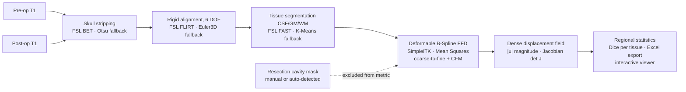
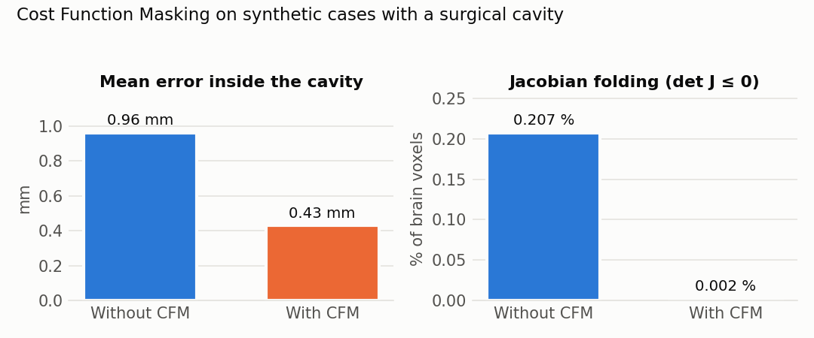
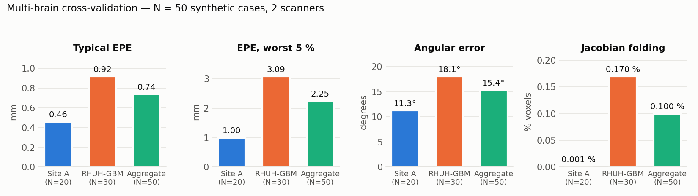

# NeuroShift — Post-operative brain shift quantification

[](https://github.com/oualidhaamdi/neuroshift/actions/workflows/tests.yml)
[](LICENSE)


An automated pipeline that estimates a **dense 3D displacement field** and its
**Jacobian determinant** between a pre-operative and a post-operative T1-weighted
MRI, and quantifies how much — and where — the brain has moved after surgery.

> [!WARNING]
> **Research software — not a medical device, not for clinical use.**
> NeuroShift has not been cleared or approved by any regulatory body. Its output
> must not be used for diagnosis, treatment planning or intra-operative guidance.

---

## The problem

Neuronavigation systems register the patient to a **pre-operative** MRI. Once the
skull and dura are opened, the brain deforms — CSF drains, tissue is resected,
gravity and swelling act on it. This *brain shift* can reach several millimetres to
over a centimetre, so the navigation map silently drifts away from the anatomy the
surgeon is looking at.

Measuring brain shift retrospectively (pre-op vs. post-op MRI) is a prerequisite
for studying it and, eventually, for compensating it. It is a hard registration
problem: the post-op image contains a **resection cavity** that has no counterpart
in the pre-op image, and a naive intensity-based registration tries to "explain"
that cavity by dragging healthy tissue into it.

## Pipeline



| Stage | Preferred backend | Automatic fallback |
|---|---|---|
| Brain extraction | FSL `bet` | Otsu threshold + morphology (SimpleITK) |
| Rigid alignment | FSL `flirt`, 6 DOF, mutual information | Euler3D + Mattes MI (SimpleITK) |
| Tissue segmentation | FSL `fast` | Multi-Otsu / K-Means (SimpleITK) |
| Deformable registration | B-Spline FFD on intensities + CFM (SimpleITK) | — |

Every stage sits behind an abstract interface (`src/backends/base.py`), so FSL can
be swapped for the SimpleITK implementation (or a new one) without touching the
orchestration code. If FSL is not reachable, the pipeline falls back automatically.

## Main contribution: Cost Function Masking (CFM)

The resection cavity is excluded from the voxels on which the registration
metric is evaluated. The optimiser is therefore never rewarded for
collapsing healthy tissue into the void, while the B-Spline grid still
interpolates a smooth displacement across the cavity from its surroundings.

<p align="center"></p>

| Synthetic cases with a cavity | Without CFM | With CFM |
|---|---|---|
| Mean error inside the cavity | 0.96 mm | **0.43 mm** |
| Jacobian folding (det J ≤ 0) | 0.207 % | **0.002 %** |

On cases **without** a cavity CFM produces no significant change, i.e. it fixes the
failure mode without costing accuracy elsewhere.

A tissue-guided variant (B-Spline on Danielsson distance maps of tissue edges) is
kept as an ablation (`REGISTRAR=tissue`); in the cavity-mismatch experiments,
intensity + CFM outperformed it, which is why it is the default.

## Validation and results

Real post-operative scans have no ground-truth displacement, so accuracy was
measured on **synthetic cases with a known deformation**: a smooth 3D Gaussian
displacement field (amplitude 3–15 mm, width σ 15–40 mm, 4 directions, 5 locations)
is applied to a real brain, and the pipeline has to recover it voxel by voxel.

- **Controlled sweep — 112 cases:** 56 without a cavity (pre-op as source) and
  56 with a real surgical cavity (post-op as source), matched pairwise to isolate
  the effect of the cavity.
- **Multi-brain cross-validation — N = 50:** synthetic cases built on different
  source brains from **two scanners**: a private clinical dataset (Site A, N = 20)
  and the public RHUH-GBM dataset (N = 30).

<p align="center"></p>

| Metric | Site A (N = 20) | RHUH-GBM (N = 30) | Aggregate (N = 50) |
|---|---|---|---|
| Typical end-point error (EPE) | 0.46 mm | 0.92 mm | **0.74 mm** |
| EPE, worst 5 % of voxels | 1.00 mm | 3.09 mm | **2.25 mm** |
| Angular error | 11.3° | 18.1° | **15.4°** |
| Jacobian folding | 0.001 % | 0.17 % | **0.10 %** |

*EPE = ‖predicted − true displacement‖ per voxel. Folding = fraction of brain voxels
with det J ≤ 0 (physically implausible, locally non-invertible deformation).*

The sweep and cross-validation are fully scripted in `src/qc/` (see
[Reproducing the validation](#reproducing-the-validation)). No imaging data is
distributed with this repository.

## Quickstart

### Requirements

- Python 3.10–3.12
- **Optional:** [FSL](https://fsl.fmrib.ox.ac.uk/) (`bet`, `flirt`, `fast`).
  The current integration calls FSL through **WSL2 on Windows**
  (`scripts/setup_fsl_wsl.sh` installs a minimal FSL there). On any other setup —
  or if FSL is missing — the SimpleITK fallbacks are used automatically.
  Note that FSL has a **non-commercial licence**.

```bash
git clone https://github.com/oualidhaamdi/neuroshift.git
cd neuroshift
python -m venv .venv && source .venv/bin/activate   # Windows: .venv\Scripts\activate
pip install -r requirements.txt
```

### Input layout

```
RunBatch_Input/
└── <CASE_ID>/
    ├── 0/   pre-operative T1  (*.nii / *.nii.gz)
    └── 1/   post-operative T1 (*.nii / *.nii.gz)
```

CFM is applied whenever a cavity mask is available, looked up in this order:
a manual mask `RunBatch_Input/<CASE_ID>/mask_cavity_manual.nii.gz` (or the same
file in the output folder), then the automatic mask
`RunBatch_Output/<CASE_ID>/mask_cavity_auto.nii.gz` written by `--analyze`.
Without a manual mask, run `--register-tissue --analyze` once to detect the
cavity, then `--register-tissue` again to register with CFM.

### Run

```bash
# Registration + quantification for one case
python main.py --register-tissue --analyze --patient <CASE_ID>

# Interactive multiplanar viewer (displacement, Jacobian, vector overlay, case selector)
python main.py --view --patient <CASE_ID>

# All cases in RunBatch_Input/, then export statistics to Excel
python batch_runner.py
python main.py --export
```

Outputs are written to `RunBatch_Output/<CASE_ID>/`, among them
`brainshift_displacement.nii.gz` (vector field, mm), `brainshift_magnitude.nii.gz`
and `brainshift_jacobian.nii.gz`, all viewable in 3D Slicer or ITK-SNAP.

Ablations are selected with environment variables:

```bash
REGISTRAR=tissue python main.py --register-tissue --analyze --patient <CASE_ID>  # tissue-guided
DISABLE_CFM=1   python main.py --register-tissue --analyze --patient <CASE_ID>  # no CFM
```

### Docker

```bash
docker build -t neuroshift .
docker run --rm neuroshift                       # runs the test-suite
docker run --rm \
  -v "$PWD/RunBatch_Input:/app/RunBatch_Input" \
  -v "$PWD/RunBatch_Output:/app/RunBatch_Output" \
  neuroshift python main.py --register-tissue --analyze --patient <CASE_ID>
```

The image contains no FSL and therefore always uses the SimpleITK backends.

### Tests

```bash
pip install -r requirements-dev.txt
pytest
```

The tests run on a small **synthetic digital phantom** (no patient data) and cover
the metrics, the synthetic ground-truth generator, the SimpleITK fallbacks, recovery
of a known Gaussian displacement by the B-Spline registrar, and the effect of CFM
near a simulated cavity. They run on GitHub Actions for Python 3.10, 3.11 and 3.12.

### Reproducing the validation

```bash
python -m src.qc.run_synthetic_sweep --source-brain <CASE_ID>          # 112-case sweep
python -m src.qc.run_synthetic_sweep --pilot --source-brain <CASE_ID>  # 12-case pilot
python -m src.qc.multi_brain_sweep --brains <ID1>,<ID2>,<ID3> --parallel 3 --cache-source
python -m src.qc.cavity_demo --source-brain <CASE_ID>                  # cavity stress test
python -m src.qc.analyze_sweep_results                                 # figures + CSV
python -m src.qc.compare_baseline                                      # registrar comparison
```

## Repository structure

```
neuroshift/
├── main.py                  # CLI entry point
├── batch_runner.py          # runs every case in RunBatch_Input/
├── export_metrics.py        # per-case statistics → Excel
├── config.py                # registration profiles, defaults
├── src/
│   ├── register_tissue.py   # pipeline orchestration (preprocessing → rigid → B-Spline + CFM)
│   ├── brain_shift_analysis.py  # displacement, magnitude, Jacobian, regional stats
│   ├── backends/            # swappable FSL / SimpleITK implementations
│   ├── metrics/             # NCC, MI, Jacobian
│   ├── qc/                  # validation: synthetic sweeps, multi-brain, cavity demo, reports
│   ├── ui/viewer.py         # interactive multiplanar viewer (matplotlib)
│   ├── data_manager.py      # input/output path resolution
│   └── fsl_wrapper.py       # FSL bridge (Windows → WSL2)
├── tests/                   # pytest suite on a synthetic phantom
├── docs/
│   ├── technical_notes.md   # methods, conventions, design decisions
│   ├── iec62304-light/      # IEC 62304 / ISO 14971-style documentation (educational)
│   └── scripts/             # regenerates the README figures
├── scripts/setup_fsl_wsl.sh # optional minimal FSL install in WSL2
└── Dockerfile
```

## Engineering documentation

[`docs/iec62304-light/`](docs/iec62304-light/) contains a software development plan,
a SOUP list, a hypothetical safety classification, an ISO 14971-style risk analysis
and a requirements-to-tests traceability matrix. It is an **educational exercise**
showing how this software would be approached in a regulated context — it is **not**
regulatory documentation.

## Limitations

- **T1-weighted MRI only**; no multimodal registration (T2, FLAIR, DWI).
- **Small real cohort**; results on real post-operative scans are qualitative.
- **Synthetic ground truth**: the Gaussian deformation and the simulated cavity
  are idealised compared to real surgical brain shift.
- Accuracy is measured against synthetic displacements, not against landmarks
  annotated by clinicians.

## Future work

- Multimodal registration (T1 + T2/FLAIR) and intra-operative ultrasound.
- Multi-centre validation on larger cohorts.
- Training learning-based registration (VoxelMorph, TransMorph) on the generated
  synthetic ground truth, using this pipeline as a reference.

## Citation

If you use this code, please cite the thesis:

```bibtex
@mastersthesis{hamdi2026neuroshift,
  author = {Hamdi, Oualid},
  title  = {Development and Validation of a Pipeline for the Quantification of Post-Operative Brain Shift},
  school = {University of Florence},
  year   = {2026},
  type   = {M.Sc. thesis in Biomedical Engineering}
}
```

See also [`CITATION.cff`](CITATION.cff). Work using the RHUH-GBM data must also
cite that dataset as required by its
[TCIA data usage policy](https://doi.org/10.7937/4545-c905).

## Acknowledgements

M.Sc. thesis in Biomedical Engineering, University of Florence (2026).
Supervisor: Prof. Leonardo Bocchi. Co-supervisors: Prof. Lucia Ballerini and
Dr. Cosimo Aliani.

## License

Code released under the [Apache License 2.0](LICENSE). FSL, which the pipeline can
call at runtime, is **not** included and is subject to its own non-commercial licence.
